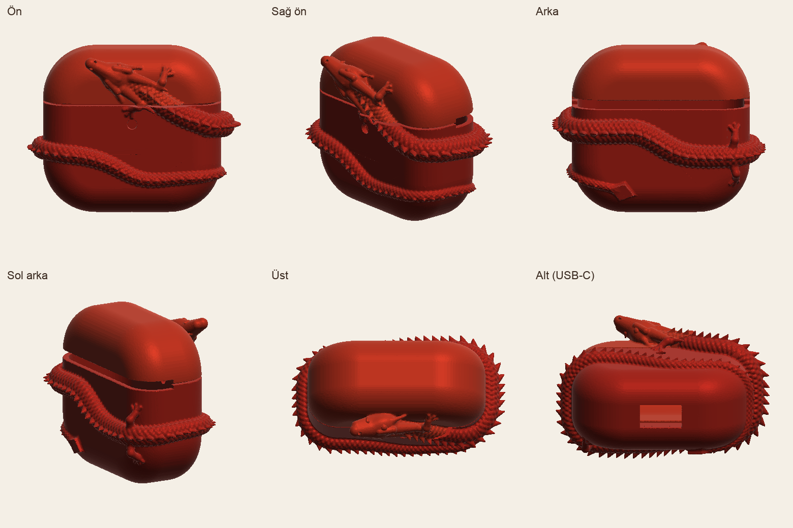
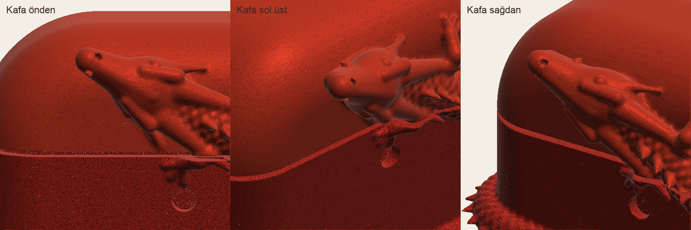
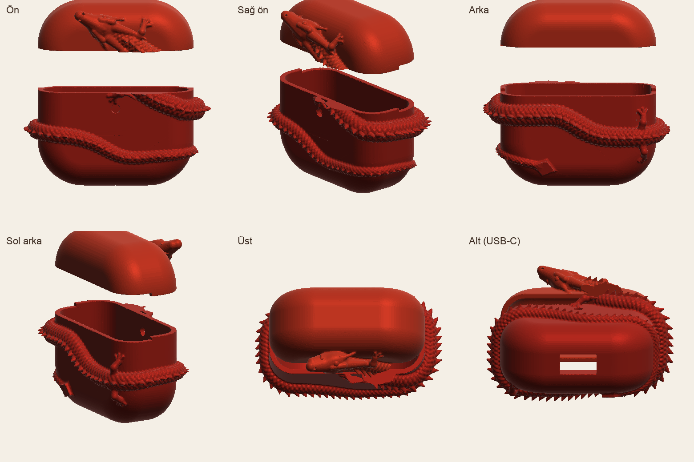

# AirPods 4 · Ejderha Kılıf

Etrafına ejderha sarılmış, iki parçalı AirPods 4 kılıfı. Gövde ve kapak ayrı basılır.

## Dosyalar

| Dosya | Ne |
|---|---|
| `airpods4-ejderha-govde.stl` | Alt parça (USB-C ve ön ışık delikleri açık) |
| `airpods4-ejderha-kapak.stl` | Kapağa geçen üst parça |
| `onizleme.png`, `onizleme-kafa.png`, `parcalar-ayrik.png` | Önizleme görselleri |
| `ejderha_kilif.py` | Modeli üreten betik (ölçü değişirse buradan yeniden üretilir) |

Her iki STL de kapalı (watertight) ağdır, ölçüler mm.

## Baskı ayarları

- **Destek:** Gerekli. Ejderha dışa taşıyor; ağaç (tree) destek önerilir.
- **Katman:** 0,12–0,16 mm (pul ve diken detayları için).
- **Duvar:** En az 3 çevre (perimeter).
- **Malzeme:** PLA veya TPU 95A.
  - PLA için kutu ile kılıf arası 0,20 mm boşluk bırakıldı; gevşek gelirse kapağın içine ince çift taraflı bant.
  - TPU ile sıkı oturur ama boşluğun 0,05 mm'ye indirilip yeniden üretilmesi gerekir.
- **Sıra:** Önce kapağı basıp kutuya oturuşunu kontrol etmek iyi olur; küçük ve hızlı biter.

## Ölçüler

- **Kutu:** 46,2 × 50,1 × 21,2 mm (Apple'ın verdiği AirPods 4 kutu ölçüsü).
- **Kılıf dış boyutu:** ejderhayla birlikte yaklaşık 65 × 37 × 50 mm.

Kapak çizgisi yüksekliği (alttan 32 mm), ön ışık yeri ve köşe yuvarlaklıkları tahminidir. Oturmazsa `ejderha_kilif.py` içindeki değerler düzeltilip yeniden üretilir.

| Kafa | Parçalar ayrık |
|---|---|
|  |  |
